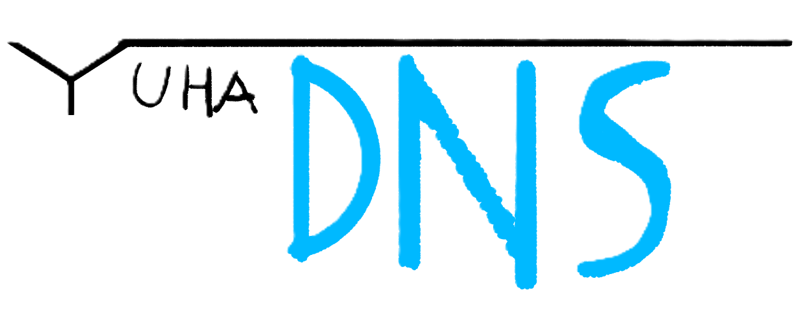

**광고와 유튜브 중독까지, 뿌리부터 뽑아버려요!**

## 작동 방식
YuhaDNS는 DoH(DNS of Https) 방식으로 작동됩니다. 쉽게 말하면 원래 그냥 평문으로 DNS를 주고받다가 이제 https로 주고받는 것인데, 여기서 https니까 클라우드페어 워커로 작동이 가능합니다. 그래서 클라우드페어 워커 기반으로 제작하게 되었습니다.
여기서 DNS는 도메인(google.com)을 IP(142.251.24.102)로 바꿔주는 것과 같습니다.

## 사용법
### 공통적으로 업스트림에 대한 내용은 [웹사이트](https://dns.ohyh2016.workers.dev)를 참고하세요.
### Windows, macOS, Linux
---
desktop의 main.py를 실행하세요
### Android 
---
app의 yuhadns.apk를 설치하세요   

### iOS, iPadOS
---
[이 웹사이트](https://simpledns.plus/apple-dot-doh)에 접속한 후 DNS query URL에 원하는 내용을 채우세요

